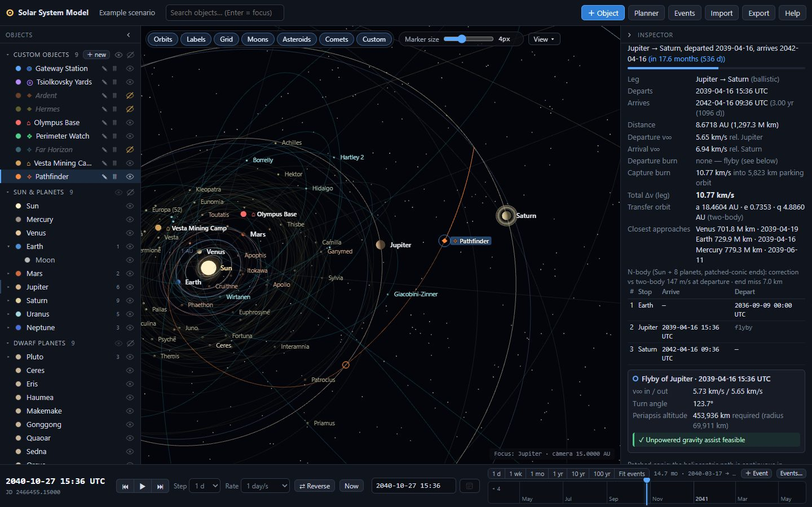
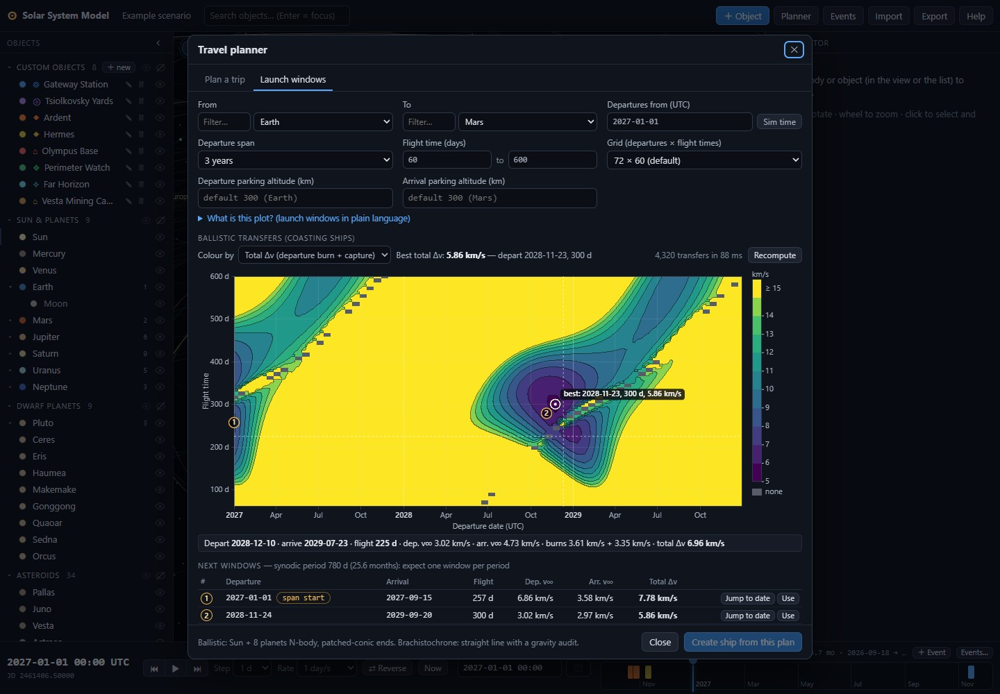

# Solar System Model

An interactive 3D model of the solar system built as a working tool for writing **hard science fiction**.
For any date it shows where the planets, major moons, dwarf planets, notable asteroids and comets are; lets
you place your own ships, fleets, stations and bases; moves ships between bodies with physically plausible
transfers; reads off distances and light-lag between any two things; and pins story events to a timeline.

Everything runs in the browser, offline, from bundled JPL data. No accounts, no server.

## Run without a terminal

No installation, no Node.js, no server:

- **Windows:** double-click **`Launch Solar System.cmd`** in the project folder, or
- **any system:** double-click **`standalone/SolarSystem.html`**.

Either one opens the app in your default browser straight from disk. `standalone/SolarSystem.html` is a single
self-contained file (about 820 KB) with all code, styles and data inside it, so it works offline and you can copy
it anywhere.

You don't need to clone the repository to get it. On the GitHub repository page, either use **Code → Download ZIP**
(unzip it, then double-click either file), or open `standalone/SolarSystem.html`, click **Download raw file**, and
double-click the downloaded file.

**Scenarios autosave inside the browser, not in a file next to the app.** Always open it with the same browser
(and the same browser profile), or your saved work won't be there and you'll see the example scenario instead.
Private/incognito windows forget everything when closed. Use **Export** to keep a backup `.json` file, and
**Import** to bring a scenario into another browser or computer.

After changing the code, regenerate the file with `npm run build:standalone`.

## Features

- **Accurate ephemeris** in the heliocentric ecliptic J2000 frame for any date (planets valid 3000 BC – 3000 AD):
  the Sun, 8 planets, the Moon, 28 major moons, 9 dwarf planets, 30 main-belt asteroids, 4 Jupiter trojans,
  14 near-Earth objects, 4 centaurs and 12 comets.
- **Seamless zoom** from the Kuiper belt down to a station in low orbit. The camera centres on the selected
  object and follows it through time; bodies keep a minimum on-screen size scaled to their real size (the Sun is
  always the largest marker, Jupiter about twice Earth, asteroids small dots), adjustable or true scale.
- **Declutter**: hide any body (with its moons and orbit) or custom object (with its path) from the object list,
  besides the category chips; collapse the object list and the inspector to thin strips.
- **Your own objects** — ships, fleets, stations, habitats, bases, probes — with five motion models:
  - **Orbit**: Kepler elements about any body (presets: LEO, MEO, geostationary, low lunar, low Mars,
    areostationary, “equatorial” variants using the body's IAU pole);
  - **Co-located**: a surface base, colony or “in orbit somewhere”;
  - **Lagrange point**: L1–L5 of any primary/secondary pair (Sun–Earth, Earth–Moon, Sun–Jupiter…);
  - **Fixed point** in heliocentric coordinates (AU or km);
  - **Route**: multi-stop itineraries whose legs fly as **brachistochrone** (constant thrust, midpoint flip —
    arrival times can be solved from the acceleration), **ballistic** (a coast through the gravity of the Sun and
    all eight planets), or **linear**. Stops can be bodies, other custom objects (escorts, shuttles) or fixed points.
- **Trajectory physics for ballistic legs**: an N-body cruise (Sun + 8 planets) targeted to arrive on time, with
  patched-conic endpoints; departure / arrival excess speeds, burns from and into parking orbits, the leg's total
  Δv, the closest planetary approaches and impact warnings. **Gravity assists**: mark an intermediate planet as a
  flyby and get v∞ in/out, turn angle, required periapsis altitude and a verdict (unpowered assist feasible,
  powered flyby Δv, or impossible turn).
- **Gravity audit for brachistochrone legs**: the thrust actually needed to hold the straight line against the
  Sun's and planets' pull, Δv including gravity, gravity loss, and whether the drive can hold the line at all.
- **Travel planner**: “how long Earth→Mars at 0.3 g?”, “what acceleration to get there in 10 days?”,
  “what does a ballistic transfer cost?” (N-body, with parking-orbit burns and a duration scan to spot cheap
  windows); turn any plan into a ship.
- **Inspector** with position, speed, distance from Sun / parent / Earth, light time, route status (current leg,
  arrival countdown, acceleration, peak velocity, Δv, v∞, burns, approaches, flybys), osculating orbital elements,
  and editable notes.
- **Distances table** from the selection to everything that matters, with one-way and round-trip light time,
  plus a persistent **measurement line** between any two objects.
- **Interactive timeline** with story events: drag the cursor to scrub time (the whole view follows live), click
  to jump, drag to pan, mouse wheel to zoom from 1 day to 500 years.


- **Autosave** in the browser, **export/import** as JSON (merge or replace), and an example scenario.

## Quick start

Requires Node.js 20.19+ or 22.12+ (developed with Node 22).

```bash
npm install          # install three.js and Vite
npm run dev          # start the dev server (http://localhost:5173)
npm run build        # production build into dist/ (works from any sub-path)
npm run build:standalone  # single-file build into standalone/SolarSystem.html (runs from disk)
npm run preview      # serve the production build locally
npm run validate     # numeric checks of the astrodynamics core (vs JPL Horizons) and of the N-body module
npm run validate:nbody  # only the N-body checks (integrator, targeting, flybys, parking orbits, gravity audit)
npm run fetch-data   # re-download small-body (SBDB) and moon (Horizons) data into src/data/
```

`npm run fetch-data` needs network access; the app itself never does.

## Using the app

### Navigating

- **Drag** to rotate around the focused object; **mouse wheel** to zoom (multiplicative, so it works at every scale).
- **Click** a body, object or its label — or a row in the object list — to select it and centre the camera on it.
- **View** menu: top-down, oblique (35°), inner system (3.5 AU), outer system (45 AU), Kuiper belt (110 AU),
  frame selection.
- Chips above the view toggle **Orbits · Labels · Grid · Moons · Asteroids · Comets · Custom**. Moons and
  orbiting objects hide automatically when their orbit would be smaller than ~10 px on screen.
- The **eye** at the end of each row in the object list hides that body (marker, label and orbit) or custom
  object (with its route path); hiding a planet hides its moons too. The eyes in each group header show or hide
  the whole group. A body is visible only if its category chip is on *and* it is not hidden individually. Hidden
  rows are dimmed and still found by the search; the hidden set is saved with the scenario.
- **Marker size** sets the minimum on-screen radius of bodies (0 = true scale). Each body's minimum is scaled by
  (R / R<sub>Earth</sub>)<sup>0.3</sup>, clamped to 0.45–3×, so markers keep their size order at every zoom.
- The chevron in the header of the object list or the inspector (or the keys **O** / **I**) collapses it to a thin
  strip; click the strip to bring it back. The 3D view widens to fill, and the layout is saved with the scenario.
- The search box filters the object list; **Enter** focuses the first match.

### Time

Play/pause, step back/forward (1 h · 1 d · 7 d · 30 d · 1 yr), choose a rate from real time to 10 years per
second, reverse time, or jump to **Now**. Type any UTC date into the date field (`2187-03-14`,
`2187-03-14 06:42`, negative years for BCE) and press Enter, or use the picker (years 1–9999). A warning appears
outside the planetary ephemeris range.

The **timeline** (bottom right) is a zoomable time axis:

- **Drag the blue cursor** to scrub: the 3D view, the inspector and the distances follow live, and playback pauses.
- **Click** anywhere on the axis to jump there; **drag the background** to pan the visible window.
- **Mouse wheel** zooms about the pointer, from 1 day to 500 years; the buttons above the strip jump to a span of
  1 d, 1 wk, 1 mo, 1 yr, 10 yr or 100 yr, and **Fit events** frames all story events and the current time.
  Tick labels switch between hours, days, months and years.
- Story events are coloured ticks: hover for the title, click to jump. Small counters at the ends show events
  outside the window.
- While playing, the window scrolls to keep the cursor in view (unless you are panning or zooming it). The span is
  saved with the scenario.

### Adding objects and routes

**＋ Object** opens the editor: name, type, colour, tags, notes, an optional existence window (the object is
hidden outside it), and the motion model. In a **route**, each stop has an arrival and a departure time. Times
can be absolute (`YYYY-MM-DD HH:MM`, UTC) or relative to the previous time (`+20` days, `+12h`, `+1y`). For
brachistochrone routes, leave an arrival blank and give an acceleration (g): the arrival is solved iteratively
so the ship meets the target where it *will* be. The editor shows every leg's distance, duration, acceleration,
peak velocity and Δv (or departure/arrival v∞, burns and total Δv for ballistic legs) and refuses inconsistent
routes.

**Ballistic legs** are computed in two steps: the two-body Lambert arc appears immediately, and within a fraction of
a second it is replaced by a trajectory integrated through the gravity of the Sun and the eight planets and
corrected to arrive at the destination on time. For each leg you get:

- the hyperbolic excess speed **v∞** at departure and arrival, relative to the stop's body (for a station in orbit,
  relative to its planet);
- the **departure burn** from a circular parking orbit and the **capture burn** into one. Set a stop's parking
  altitude in the editor (blank = default: 300 km for rocky planets and large moons, 10% of the radius for gas
  giants, half the radius (at least 5 km) for small bodies; a station's own orbit when the stop is a station);
  Lagrange points and fixed points have no parking orbit, so the burn is the full velocity change;
- the leg's **total Δv**, the **three closest approaches** to other planets (distance and date; “close approach”
  inside two sphere-of-influence radii), a red **IMPACTS** badge if the path hits a planet, and the size of the
  N-body correction compared with the two-body solution.

Tick **flyby (no stop)** on an intermediate stop of a ballistic route to pass a planet without stopping (a moon
uses its planet's gravity). The inspector and editor then show the flyby analysis: v∞ in and out, the turn angle,
the periapsis altitude needed for that turn, and a verdict — *Unpowered gravity assist feasible*, *Needs powered
flyby: Δv ≈ X km/s*, or *Turn too sharp: periapsis below the surface*. The flyby point is marked with a small ring
on the path. The route total adds powered-flyby Δv to the burns.

**Brachistochrone legs** stay straight lines, but each gets a **gravity audit**: the peak engine acceleration needed
to hold the line against the Sun's and planets' pull, the Δv including gravity, the gravity loss, and a status —
OK, *Marginal: engine needs X% more thrust than rated*, or *Cannot hold a straight line at this thrust* (raise the
acceleration or fly that leg ballistic).

### Planner

**Planner** → choose from/to (any body or custom object) and the departure date, then:

1. *Brachistochrone, given acceleration* → duration, arrival date, peak velocity, Δv, and the gravity audit;
2. *Brachistochrone, given duration* → required acceleration (g and m/s²), peak velocity, Δv, and the gravity audit;
3. *Ballistic (N-body), given duration* → departure and arrival v∞, parking-orbit burns (editable parking
   altitudes at both ends), total Δv, closest approaches, transfer orbit, and a scan of durations from 60 days to
   3 years whose rows fill in with N-body numbers as they are computed.

The straight-line distance and one-way light time at departure are always shown. **Create ship from this plan**
opens the editor with a two-stop route filled in.

### Measuring

Select an object and press **Measure to…**, then click a second object: a line with the distance (AU, million km)
and light time stays on screen until cleared. The **Distances** tab lists distance, one-way and round-trip light
time from the selection to the Sun, all planets, the Moon, sibling moons and every custom object.

### Events

**＋ Event** (above the timeline) adds a story event at the current time; **Events…** manages them (date, title,
notes, colour). They appear as ticks on the timeline strip; click a tick to jump there.

### Saving

Everything autosaves to `localStorage` (key `ssm.scenario.v1`). **Export** downloads
`<name>.solarsystem.json`; **Import** previews a file and merges it into, or replaces, the current scenario. The
Import dialog also starts a new empty scenario or reloads the example. Rename the scenario by clicking its name in
the top bar.

### Keyboard shortcuts

| Key | Action |
|---|---|
| `Space` | Play / pause |
| `,` / `.` | Step back / forward |
| `[` / `]` | Slower / faster |
| `N` | Jump to now |
| `O` / `I` | Collapse / expand the object list / the inspector |
| `Esc` | Close dialogs, cancel measuring |
| `Enter` (in search) | Focus the first match |

## Scenario JSON format

```json
{
  "version": 1,
  "name": "My Story",
  "savedAt": "2026-10-12T04:37:31.600Z",
  "objects": [
    {
      "id": "c0ffee", "name": "ISV Kestrel", "type": "ship", "color": "#ff8800",
      "notes": "Fast courier", "tags": ["Navy", "Act 2"],
      "existsFromJd": null, "existsUntilJd": null, "showPath": true,
      "motion": {
        "kind": "route", "profile": "brachistochrone", "accelG": 0.3,
        "stops": [
          { "ref": "earth", "arriveJd": null, "departJd": 2461334.5 },
          { "ref": "mars", "arriveJd": 2461341.04, "departJd": null }
        ]
      }
    },
    { "id": "gw", "name": "Gateway", "type": "station", "color": "#5aa9ff", "notes": "", "tags": [],
      "existsFromJd": null, "existsUntilJd": null, "showPath": true,
      "motion": { "kind": "orbit", "parent": "earth", "aKm": 42164, "e": 0, "iDeg": 0, "omDeg": 0, "wDeg": 0, "m0Deg": 0, "epochJd": 2461325.5 } }
  ],
  "events": [ { "id": "e1", "jd": 2461334.5, "title": "Kestrel departs", "notes": "", "color": "#ffcc66" } ],
  "view": { "jd": 2461325.5, "focus": "earth", "selection": null, "toggles": { "orbits": true, "labels": true },
            "markerPx": 4, "cameraDistance": 0.0064, "hiddenIds": ["jupiter"],
            "sidebarCollapsed": false, "inspectorCollapsed": false, "timelineSpan": 365.25 }
}
```

`hiddenIds` lists bodies and objects hidden with the eye toggles; `timelineSpan` is the visible span of the
timeline in days (`null` = fit the events). Route stops may carry `"parkAltKm": 400` (parking-orbit altitude for
the burns at that stop) and `"flyby": true` (an intermediate stop passed without stopping: `arriveJd` equals
`departJd`).

Times are Julian Dates (UTC). Other motion kinds:
`{ "kind": "colocated", "parent": "mars", "label": "Surface" }`,
`{ "kind": "lagrange", "primary": "earth", "secondary": "moon", "point": "L2" }`,
`{ "kind": "fixed", "x": 1.2, "y": -0.4, "z": 0 }` (heliocentric ecliptic J2000, AU).
Route stops may use `"ref": null` with `x, y, z` (AU) for a fixed point. Body ids are lower-case names
(`earth`, `io`, `ceres`, `hale-bopp`, `tempel-1`; the asteroid 52 Europa is `europa-52`).

## Accuracy & data sources

- **Planets**: JPL/Standish Keplerian approximation ([approximate positions of the planets](https://ssd.jpl.nasa.gov/planets/approx_pos.html)),
  valid 3000 BC–3000 AD; typical error a few arcminutes in heliocentric longitude (Jupiter up to ~5′ far from
  J2000), i.e. ~10⁵–10⁶ km. Good for story geometry, not for navigation.
- **Moon**: truncated Meeus series (*Astronomical Algorithms*, ch. 47), ~0.02° (≈150 km).
- **Small bodies**: [JPL Small-Body Database](https://ssd-api.jpl.nasa.gov/doc/sbdb.html) osculating elements at
  their epoch, propagated as unperturbed Kepler orbits. Accurate for a few decades around the epoch for
  main-belt asteroids; comets and NEOs drift quickly (planetary perturbations and outgassing ignored).
  Re-run `npm run fetch-data` to refresh.
- **Moons**: [JPL Horizons](https://ssd.jpl.nasa.gov/horizons/) osculating elements at J2000 propagated as fixed
  Kepler orbits; orbit planes are right, phases drift over decades.
- **Ballistic legs**: integrated (adaptive Dormand–Prince 5(4)) in the gravity of the Sun and the 8 planets — Earth
  and the Moon act as one body with their combined mass at the Earth–Moon barycentre — and targeted by differential
  correction from the two-body Lambert solution so the ship arrives on time. **Patched-conic endpoints**: the
  departure and arrival planets' gravity is switched off inside their sphere of influence (ramping back to full
  strength by 2 SOI radii), and the departure / capture burns are computed from the hyperbolic excess speed for a
  circular parking orbit. Moons, dwarf planets and asteroids do not perturb trajectories. If targeting does not
  converge, the two-body arc is shown with a warning.
- **Flybys** are patched conics: the heliocentric path is continuous in position but kinks in velocity at the flyby
  planet; the turn is checked against the periapsis it needs (unpowered if the v∞ in and out agree within 3% and the
  periapsis clears the surface by 5%); the hyperbola inside the sphere of influence is not modelled in detail.
- **Brachistochrone legs** are straight lines at constant thrust with a midpoint flip; gravity does not bend them but
  is accounted for by the gravity audit (required engine acceleration and Δv). Constant-thrust legs below ~0.01 g are
  outside the model's validity: the Sun's pull at 1 AU (0.0006 g) becomes comparable to the thrust and a straight
  line is no longer a meaningful trajectory.
- **Light time**: straight-line distance / c, no relativistic corrections.

`npm run validate` checks the core against Horizons reference vectors (Earth, Mars, Jupiter, Neptune, the Moon),
checks the Kepler, Lambert, universal-propagation and Lagrange code for self-consistency, and then runs the N-body
checks (integrator vs two-body propagation, perturber cache, targeting Earth→Mars and Earth→Jupiter→Saturn,
flyby and parking-orbit formulas, brachistochrone gravity audits at 0.3, 0.01 and 0.0005 g).

## Publishing to GitHub Pages

The repository includes a manual workflow, **Deploy to GitHub Pages** (`.github/workflows/deploy.yml`). To publish:

1. Open the repository's **Actions** tab, choose **Deploy to GitHub Pages**, and click **Run workflow**.
2. If the run fails at the Pages configuration step, go to **Settings → Pages** and set **Source** to
   **GitHub Actions** (the workflow's `enablement` step normally does this), then run it again.

The site is then served at `https://<user>.github.io/solarsystemmodel/`. The build uses relative paths
(`base: './'`), so it works under any sub-path.

## Project structure

```
index.html                  app shell (bars, panels)
vite.config.js              base: './'
vite.standalone.config.js   single-file build (vite-plugin-singlefile) -> standalone/SolarSystem.html
standalone/SolarSystem.html prebuilt self-contained app; double-click to run from disk
Launch Solar System.cmd     Windows launcher for the standalone file
scripts/fetch-data.mjs      downloads SBDB + Horizons data into src/data/*.json
scripts/validate-astro.mjs  numeric validation of src/astro/
scripts/validate-nbody.mjs  numeric validation of src/astro/nbody.js
src/main.js                 bootstrap
src/styles.css              dark theme
src/astro/                  astrodynamics core: time, Kepler, Lambert, Lagrange, planets & Moon, N-body (nbody.js)
src/data/                   catalog.js (Sun/planets table, colours, loader) + generated JSON
src/sim/                    ephemeris (+ N-body perturbers), custom-object motion, trajectory job queue,
                            leg physics (burns, flybys, audits), clock, store, scenario persistence
src/scene/                  three.js renderer, bodies, custom objects, grid, starfield, measurement line
src/ui/                     top bar, sidebar, panels, inspector, leg info, time bar, timeline, modals, formatting
```

## License

MIT © Sam (thatotherguy012)

Permission is hereby granted, free of charge, to any person obtaining a copy of this software and associated
documentation files (the “Software”), to deal in the Software without restriction, including without limitation
the rights to use, copy, modify, merge, publish, distribute, sublicense, and/or sell copies of the Software, and
to permit persons to whom the Software is furnished to do so, subject to the following conditions:

The above copyright notice and this permission notice shall be included in all copies or substantial portions of
the Software.

THE SOFTWARE IS PROVIDED “AS IS”, WITHOUT WARRANTY OF ANY KIND, EXPRESS OR IMPLIED, INCLUDING BUT NOT LIMITED TO
THE WARRANTIES OF MERCHANTABILITY, FITNESS FOR A PARTICULAR PURPOSE AND NONINFRINGEMENT. IN NO EVENT SHALL THE
AUTHORS OR COPYRIGHT HOLDERS BE LIABLE FOR ANY CLAIM, DAMAGES OR OTHER LIABILITY, WHETHER IN AN ACTION OF
CONTRACT, TORT OR OTHERWISE, ARISING FROM, OUT OF OR IN CONNECTION WITH THE SOFTWARE OR THE USE OR OTHER DEALINGS
IN THE SOFTWARE.

Ephemeris data courtesy of NASA/JPL Solar System Dynamics.

## Launch windows

**Planner → Launch windows** answers “when should my ship leave?”. It has two charts.



### Coasting ships: the porkchop plot

Each point of the plot is one possible coasting (ballistic) trip: leave on the date along the bottom, fall freely
around the Sun for the flight time on the left, arrive. The colour is what that trip costs — **dark is cheap**, bright
yellow is expensive or off the scale. Cheap trips bunch into dark islands: these are the **launch windows**. The plot
gets its name from their shape.

The cost is the **total Δv**: the burn that throws the ship out of a circular parking orbit at departure plus the burn
that captures it into a parking orbit at the destination (300 km for rocky planets and large moons, 10% of the radius
for gas giants, half the radius for small bodies, a station's own orbit when you leave from a station — the same rules
as ships' ballistic legs; you can change both altitudes). The **Colour by** menu also shows the departure v∞, the
arrival v∞ (the leftover speed relative to the planet once far from it) or the departure burn alone.

Why windows? A coasting ship spends months on a Sun-centred orbit, so it can only leave when the target will be at the
right place when it gets there. That geometry repeats once per **synodic period**, the time the two planets take to
return to the same positions relative to each other: about **every 26 months for Earth and Mars**, about **every
13 months for Earth and Jupiter** (Jupiter moves so slowly that Earth laps it every year and a month). A window usually
has two lobes: short trips that go less than halfway round the Sun and long trips that go more than halfway. Trips of
almost exactly half an orbit (180°) are left grey: their orbital plane is undefined and they would need an enormous
plane change.

How to use it:

- Choose **From** and **To** (any body or your own objects), the first departure date (default: the current simulation
  date), the **span** (6 months to 5 years), the range of flight times (default 60–600 days) and the grid (default
  72 × 60 = 4,320 transfers). The plot computes in the background in a fraction of a second; a progress bar and
  **Cancel** appear for large grids.
- **Hover** for the numbers of any trip: departure and arrival dates, flight time, both v∞, both burns and the total Δv.
  The white ring marks the cheapest trip (“best: 2028-11-23, 300 d, 5.86 km/s” for Earth → Mars).
- **Click** a point to select it: the planner switches to its ballistic mode with that departure and duration, refines
  the trip with the full N-body model and shows the same numbers a ship would (burns, closest approaches, impacts).
  **Create ship from this plan** turns it into a route.
- **Next windows** lists the cheapest trip of each window in the span (one per synodic period), with **Jump to date**
  (moves the simulation there) and **Use** (selects it). A window flagged *span start* / *span end* probably continues
  outside the span.

**Speed versus accuracy:** to compute thousands of trips in a moment the plot uses two-body transfers (Lambert's
problem with the Sun's gravity only). The trip you select is refined in the Sun + 8 planets N-body model, so its
numbers can differ slightly from the colour under the pointer.

### Torch ships: the window curve

The second chart shows a constant-thrust ship's trip time (and peak speed) for every departure date in the span, for
the chosen acceleration (default 0.3 g) in **rendezvous** mode (flip and brake to match the target's speed) or
**intercept** mode (burn all the way). Its point: launch windows hardly matter to torch ships. At 0.3 g, Earth → Mars
takes 4–8 days whenever you leave — the spread is just the changing distance — while the cheapest coasting trip over
the same years swings from about 6 km/s to over 25 km/s. Torch ships cross the inner system in days, so the planets
barely move during the trip and nothing has to line up. Click the curve to plan that flight (the planner's
brachistochrone mode, with its gravity audit) and create a ship from it. The curve uses the gravity-free constant-thrust
solution starting from the departure body's own velocity; below about 0.01 g it is only indicative.

`node scripts/validate-porkchop.mjs` checks the launch-window maths (Earth–Mars minimum 5.5–6.5 km/s in the late-2028
window, synodic periods, window spacing for Earth–Jupiter, torch trip times).
