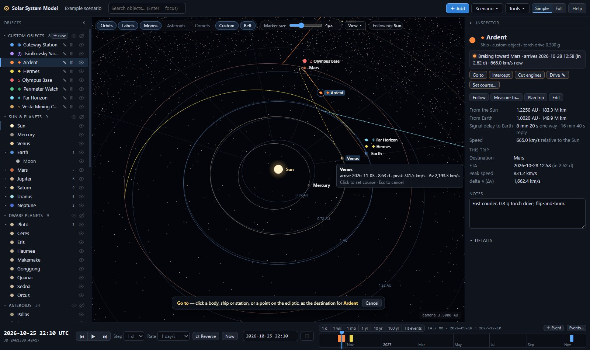
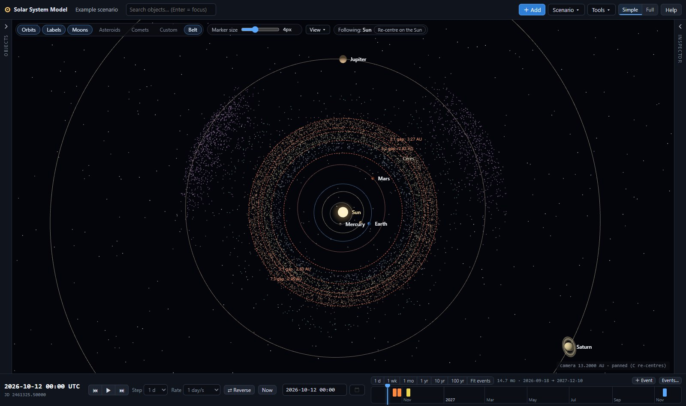
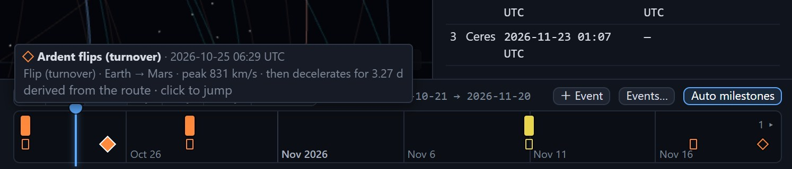
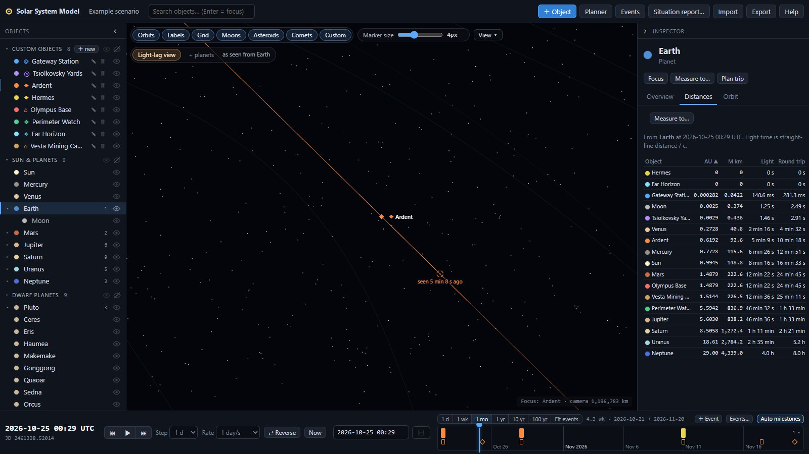

# Solar System Model

An interactive 3D model of the solar system built as a working tool for writing **hard science fiction**.
For any date it shows where the planets, major moons, dwarf planets, notable asteroids and comets are; lets
you place your own ships, fleets, stations and bases; moves ships between bodies with physically plausible
transfers; reads off distances and light-lag between any two things; and pins story events to a timeline.

Everything runs in the browser, offline, from bundled JPL data. No accounts, no server.

## Run without a terminal

No installation, no Node.js, no server:

- **Windows:** double-click **`Launch Solar System.cmd`** in the project folder, or
- **any system:** double-click **`standalone/SolarSystem.html`**.

Either one opens the app in your default browser straight from disk. `standalone/SolarSystem.html` is a single
self-contained file (about 1.4 MB, most of it the asteroid-belt data) with all code, styles and data inside it, so it works offline and you can copy
it anywhere.

You don't need to clone the repository to get it. On the GitHub repository page, either use **Code → Download ZIP**
(unzip it, then double-click either file), or open `standalone/SolarSystem.html`, click **Download raw file**, and
double-click the downloaded file.

**Scenarios autosave inside the browser, not in a file next to the app.** Always open it with the same browser
(and the same browser profile), or your saved work won't be there and you'll see the example scenario instead.
Private/incognito windows forget everything when closed. Use **Scenario ▾ → Export** to keep a backup `.json` file,
and **Scenario ▾ → Import** to bring a scenario into another browser or computer.

After changing the code, regenerate the file with `npm run build:standalone`.

## Features

- **Accurate ephemeris** in the heliocentric ecliptic J2000 frame for any date (planets valid 3000 BC – 3000 AD):
  the Sun, 8 planets, the Moon, 28 major moons, 9 dwarf planets, 30 main-belt asteroids, 4 Jupiter trojans,
  14 near-Earth objects, 4 centaurs and 12 comets.
- **Seamless zoom** from the Kuiper belt down to a station in low orbit. The camera centres on the selected
  object and follows it through time; bodies keep a minimum on-screen size scaled to their real size (the Sun is
  always the largest marker, Jupiter about twice Earth, asteroids small dots), adjustable or true scale.
- **Declutter**: hide any body (with its moons and orbit) or custom object (with its path) from the object list,
  besides the category chips; collapse the object list and the inspector to thin strips.
- **Command your ships**: select a ship and press **G** (go to) or **T** (intercept), point at a planet, moon, another ship,
  a station or empty space, and click. The ship leaves *from where it really is, at its current speed*: torch ships fly a
  constant-thrust burn–flip–brake course solved under the Sun's and planets' gravity, coast ships make one burn and
  follow a ballistic arc. Its earlier path is kept, so scrubbing back in time shows what it did before the order. Cut the
  engines to let a ship drift; command several ships at once with shift-click; undo any order.
- **The real asteroid belt**: every known asteroid larger than about 10 km (7,674 of them, JPL data) moving on its true
  orbit, coloured by zone, with the Kirkwood gaps, the Hilda group and the two Jupiter Trojan clouds.
- **Simple or Full detail**: Simple mode answers the everyday questions in plain language (where is it, what is it doing,
  how far, how long until a signal gets there, when does it arrive); Full mode shows every technical table.
- **Your own objects** — ships, fleets, stations, habitats, bases, probes — with five motion models:
  - **Orbit**: Kepler elements about any body (presets: LEO, MEO, geostationary, low lunar, low Mars,
    areostationary, “equatorial” variants using the body's IAU pole);
  - **Co-located**: a surface base, colony or “in orbit somewhere”;
  - **Lagrange point**: L1–L5 of any primary/secondary pair (Sun–Earth, Earth–Moon, Sun–Jupiter…);
  - **Fixed point** in heliocentric coordinates (AU or km);
  - **Route**: multi-stop itineraries whose legs fly as **torch** (constant thrust from the ship's actual position and
    velocity, rendezvous or intercept, arrival solved), **brachistochrone** (legacy straight line, constant thrust,
    midpoint flip), **ballistic** (a coast through the gravity of the Sun and all eight planets), or **linear**. Stops can
    be bodies, other custom objects (escorts, shuttles), fixed points, or course changes recorded by commands.
- **Trajectory physics for ballistic legs**: an N-body cruise (Sun + 8 planets) targeted to arrive on time, with
  patched-conic endpoints; departure / arrival excess speeds, burns from and into parking orbits, the leg's total
  Δv, the closest planetary approaches and impact warnings. **Gravity assists**: mark an intermediate planet as a
  flyby and get v∞ in/out, turn angle, required periapsis altitude and a verdict (unpowered assist feasible,
  powered flyby Δv, or impossible turn).
- **Gravity audit for brachistochrone legs**: the thrust actually needed to hold the straight line against the
  Sun's and planets' pull, Δv including gravity, gravity loss, and whether the drive can hold the line at all.
- **Travel planner**: “how long Earth→Mars at 0.3 g?”, “what acceleration to get there in 10 days?”,
  “what does a ballistic transfer cost?” (N-body, with parking-orbit burns and a duration scan to spot cheap
  windows); turn any plan into a ship.
- **Inspector** with position, speed, distance from Sun / parent / Earth, light time, route status (current leg,
  arrival countdown, acceleration, peak velocity, Δv, v∞, burns, approaches, flybys), osculating orbital elements,
  and editable notes.
- **Distances table** from the selection to everything that matters, with one-way and round-trip light time,
  plus a persistent **measurement line** between any two objects.
- **Interactive timeline** with story events: drag the cursor to scrub time (the whole view follows live), click
  to jump, drag to pan, mouse wheel to zoom from 1 day to 500 years.





- **Autosave** in the browser, **export/import** as JSON (merge or replace), and an example scenario.

## Quick start

Requires Node.js 20.19+ or 22.12+ (developed with Node 22).

```bash
npm install          # install three.js and Vite
npm run dev          # start the dev server (http://localhost:5173)
npm run build        # production build into dist/ (works from any sub-path)
npm run build:standalone  # single-file build into standalone/SolarSystem.html (runs from disk)
npm run preview      # serve the production build locally
npm run validate     # numeric checks: astrodynamics core (vs JPL Horizons), N-body module, torch maneuvers
npm run validate:nbody     # only the N-body checks (integrator, targeting, flybys, parking orbits, gravity audit)
npm run validate:maneuver  # only the constant-thrust rendezvous / intercept checks
npm run fetch-data   # re-download small-body (SBDB) and moon (Horizons) data into src/data/
npm run fetch-belt   # re-download the asteroid-belt cloud (SBDB query: every asteroid with H < 13) into src/data/belt.json
```

`npm run fetch-data` and `npm run fetch-belt` need network access; the app itself never does.

## Using the app

### Navigating

- **Drag** to rotate; **right-drag** (or **shift + drag**) to pan; **mouse wheel** to zoom (multiplicative, so it works at
  every scale).
- **Click** a body, object or its label — or a row in the object list — to select it; the camera then **follows** it
  through time. The pill above the view says what the camera follows (“Following: Jupiter”) and has **Follow Sun**.
- **Esc** or a click on empty space clears the selection; the camera keeps following the same object.
- Panning moves the view away from the followed object, and the view keeps following it while time runs. **Double-click**
  the object or press **C** to re-centre; following something else resets the pan.
- **View** menu: top-down, oblique (35°), inner system (3.5 AU), asteroid belt top-down (13 AU), outer system (45 AU),
  Kuiper belt (110 AU), frame selection, re-centre — plus the rarely needed layers: **Ecliptic grid**, **Kirkwood gaps** and
  **Belt at average distance**.
- Chips above the view toggle **Orbits · Labels · Moons · Asteroids · Comets · Custom · Belt**. Moons and
  orbiting objects hide automatically when their orbit would be smaller than ~10 px on screen.
- **Simple / Full** (top right) switches the inspector and the object form between plain-language summaries and the full
  technical detail. In Simple mode the inspector shows a status line (“Under thrust toward Venus · flip in 5.5 d · arrives
  2026-11-03 (in 8.6 d) · 665 km/s now”), distances from the Sun and Earth, the **signal delay** to Earth, speed, and the
  current trip (ETA, peak speed, delta-v); **Details** opens the technical tabs.
- A tip strip on first start lists the basic controls; close it with ✕ (it stays closed).
- The **eye** at the end of each row in the object list hides that body (marker, label and orbit) or custom
  object (with its route path); hiding a planet hides its moons too. The eyes in each group header show or hide
  the whole group. A body is visible only if its category chip is on *and* it is not hidden individually. Hidden
  rows are dimmed and still found by the search; the hidden set is saved with the scenario.
- **Marker size** sets the minimum on-screen radius of bodies (0 = true scale). Each body's minimum is scaled by
  (R / R<sub>Earth</sub>)<sup>0.3</sup>, clamped to 0.45–3×, so markers keep their size order at every zoom.
- The chevron in the header of the object list or the inspector (or the keys **O** / **I**) collapses it to a thin
  strip; click the strip to bring it back. The 3D view widens to fill, and the layout is saved with the scenario.
- The search box filters the object list; **Enter** focuses the first match.

### Time

Play/pause, step back/forward (1 h · 1 d · 7 d · 30 d · 1 yr), choose a rate from real time to 10 years per
second, reverse time, or jump to **Now**. Type any UTC date into the date field (`2187-03-14`,
`2187-03-14 06:42`, negative years for BCE) and press Enter, or use the picker (years 1–9999). A warning appears
outside the planetary ephemeris range.

The **timeline** (bottom right) is a zoomable time axis:

- **Drag the blue cursor** to scrub: the 3D view, the inspector and the distances follow live, and playback pauses.
- **Click** anywhere on the axis to jump there; **drag the background** to pan the visible window.
- **Mouse wheel** zooms about the pointer, from 1 day to 500 years; the buttons above the strip jump to a span of
  1 d, 1 wk, 1 mo, 1 yr, 10 yr or 100 yr, and **Fit events** frames all story events and the current time.
  Tick labels switch between hours, days, months and years.
- Story events are coloured ticks: hover for the title, click to jump. Small counters at the ends show events
  outside the window.
- While playing, the window scrolls to keep the cursor in view (unless you are panning or zooming it). The span is
  saved with the scenario.

### Commanding ships

Select a ship, fleet or probe: a command bar appears at the bottom of the 3D view (the same buttons are in the inspector).

- **Go to** (**G**) — fly to a destination and arrive matching its speed (rendezvous). **Intercept** (**T**) — reach it
  as fast as possible and fly through at the closing speed.
- After pressing either, the cursor becomes a crosshair. Point at a planet, moon, asteroid, another ship or a station:
  the planned path appears as a dashed yellow line and a tooltip gives the arrival date, trip time, peak speed and
  delta-v (Δv) — for a coast ship, the burn needed now and the arrival burn. Point at empty space to target a point on
  the ecliptic plane (a small marker shows it). **Click** to set the course; the confirmation has an **Undo** button.
  **Esc** cancels.
- The new course starts at the current simulation time, from the ship's actual position and velocity. The route is cut
  there and a *course change* stop records the ship's state, so the past is unchanged: scrub back and the ship is on its
  old path until the moment of the order.
- **Torch** ships (constant thrust, e.g. 0.3 g) burn toward the target, flip and brake (rendezvous), or burn all the way
  (intercept). The course is solved from the ship's real velocity — a ship racing toward Mars that is sent to Venus first
  kills its old velocity — and refined under the gravity of the Sun and the planets.
- **Coast** ships make one burn now and coast on a ballistic arc; the transfer time is the cheapest of eight between
  0.3× and 2.5× a Hohmann-like transfer (change it in **Set course…** or the route editor), and the arc is then
  integrated through the planets' gravity.
- **Cut engines** stops thrusting: the ship coasts on with its current velocity (the dashed line shows the next three
  years, through the Sun's and planets' gravity). After an intercept the ship also flies on past the target.
- **Drive** sets the torch acceleration, or coast, for the selected ship(s). **Set course…** opens the detailed version:
  destination (or a typed point), rendezvous or intercept, torch by acceleration or by **arrival date** (the acceleration
  is solved), or a ballistic coast with a duration scan.
- **Shift-click** more ships (in the view or the list) to command them together; one Undo reverts all of them.
- The inspector's status line follows the ship: “Under thrust toward Mars · flip in 2.1 d · arrives …”, “Under thrust
  toward Hermes (intercept) · … · closing at 1,155 km/s”, “Engines off · drifting at 31 km/s”, “Parked at Earth”.

### The asteroid belt

The **Belt** chip shows every known asteroid larger than about 10 km — absolute magnitude H < 13 in JPL's Small-Body
Database, 7,674 objects inside 6 AU — as a cloud of dots moving on their real orbits. Colours mark the inner belt
(inside 2.5 AU), the middle belt, the outer belt (beyond 2.82 AU), the Hilda group near 4 AU (in 3:2 resonance with
Jupiter) and the two Jupiter Trojan clouds 60° ahead of and behind Jupiter. Hover a dot for its name.

So, are there denser parts? Yes: the structure is real. The **Kirkwood gaps** (View menu) at 2.06, 2.50, 2.82, 2.95 and
3.27 AU are orbits that resonances with Jupiter have emptied; the Hildas and the Trojans are clumps held by Jupiter. The
gaps are gaps in *orbit size*: because most asteroid orbits are a little eccentric, a snapshot of true positions smears
them out, so **View → Belt at average distance** draws each asteroid at its semi-major axis (in the direction where it
really is) and the gaps stand out clearly.

For navigation or combat, though, the belt is empty space. All of it together has about 4% of the Moon's mass, and
kilometre-size rocks are typically millions of kilometres apart: a ship crossing the belt would not see a single
asteroid without a telescope. Density matters for where settlements and mining would plausibly be, not for dodging rocks.

### Adding objects and routes

**＋ Add** opens the editor. In Simple mode it asks for the name, type, colour, **drive** (ships, fleets and probes: torch
at a given acceleration, coast, or none), the **starting location** (pick a body, or **Click on map** and click a body or a
point on the ecliptic in the 3D view) and notes; everything else is under **Advanced**. Full mode shows everything: tags,
an optional existence window (the object is hidden outside it), and the motion model. In a **route**, each stop has an arrival and a departure time. Times
can be absolute (`YYYY-MM-DD HH:MM`, UTC) or relative to the previous time (`+20` days, `+12h`, `+1y`). Each
stop after the first has a **Leg** choice (the route default, torch rendezvous / intercept with an optional acceleration,
ballistic, ballistic intercept, brachistochrone, linear). **Torch** legs always solve their own arrival. For
brachistochrone legs, leave an arrival blank and give an acceleration (g): the arrival is solved iteratively
so the ship meets the target where it *will* be. Course changes made with the command bar appear as grey rows. The editor shows every leg's distance, duration, acceleration,
peak velocity and Δv (or departure/arrival v∞, burns and total Δv for ballistic legs) and refuses inconsistent
routes.

**Ballistic legs** are computed in two steps: the two-body Lambert arc appears immediately, and within a fraction of
a second it is replaced by a trajectory integrated through the gravity of the Sun and the eight planets and
corrected to arrive at the destination on time. For each leg you get:

- the hyperbolic excess speed **v∞** at departure and arrival, relative to the stop's body (for a station in orbit,
  relative to its planet);
- the **departure burn** from a circular parking orbit and the **capture burn** into one. Set a stop's parking
  altitude in the editor (blank = default: 300 km for rocky planets and large moons, 10% of the radius for gas
  giants, half the radius (at least 5 km) for small bodies; a station's own orbit when the stop is a station);
  Lagrange points and fixed points have no parking orbit, so the burn is the full velocity change;
- the leg's **total Δv**, the **three closest approaches** to other planets (distance and date; “close approach”
  inside two sphere-of-influence radii), a red **IMPACTS** badge if the path hits a planet, and the size of the
  N-body correction compared with the two-body solution.

Tick **flyby (no stop)** on an intermediate stop of a ballistic route to pass a planet without stopping (a moon
uses its planet's gravity). The inspector and editor then show the flyby analysis: v∞ in and out, the turn angle,
the periapsis altitude needed for that turn, and a verdict — *Unpowered gravity assist feasible*, *Needs powered
flyby: Δv ≈ X km/s*, or *Turn too sharp: periapsis below the surface*. The flyby point is marked with a small ring
on the path. The route total adds powered-flyby Δv to the burns.

**Brachistochrone legs** stay straight lines, but each gets a **gravity audit**: the peak engine acceleration needed
to hold the line against the Sun's and planets' pull, the Δv including gravity, the gravity loss, and a status —
OK, *Marginal: engine needs X% more thrust than rated*, or *Cannot hold a straight line at this thrust* (raise the
acceleration or fly that leg ballistic).

### Planner

**Tools ▾ → Travel planner** → choose from/to (any body or custom object) and the departure date, then:

1. *Brachistochrone, given acceleration* → duration, arrival date, peak velocity, Δv, and the gravity audit;
2. *Brachistochrone, given duration* → required acceleration (g and m/s²), peak velocity, Δv, and the gravity audit;
3. *Ballistic (N-body), given duration* → departure and arrival v∞, parking-orbit burns (editable parking
   altitudes at both ends), total Δv, closest approaches, transfer orbit, and a scan of durations from 60 days to
   3 years whose rows fill in with N-body numbers as they are computed.

The straight-line distance and one-way light time at departure are always shown. **Create ship from this plan**
opens the editor with a two-stop route filled in.

### Measuring

Select an object and press **Measure to…**, then click a second object: a line with the distance (AU, million km)
and light time stays on screen until cleared. The **Distances** tab lists distance, one-way and round-trip light
time from the selection to the Sun, all planets, the Moon, sibling moons and every custom object.

### Events

**＋ Event** (above the timeline) adds a story event at the current time; **Events…** (or **Tools ▾ → Story events**) manages them (date, title,
notes, colour). They appear as ticks on the timeline strip; click a tick to jump there.

### Saving

Everything autosaves to `localStorage` (key `ssm.scenario.v1`). **Scenario ▾ → Export** downloads
`<name>.solarsystem.json`; **Scenario ▾ → Import** previews a file and merges it into, or replaces, the current scenario.
The same menu starts a new empty scenario or reloads the example. Rename the scenario by clicking its name in
the top bar.

### Keyboard shortcuts

| Key | Action |
|---|---|
| `Space` | Play / pause |
| `,` / `.` | Step back / forward |
| `[` / `]` | Slower / faster |
| `N` | Jump to now |
| `O` / `I` | Collapse / expand the object list / the inspector |
| `G` / `T` | Selected ship(s): Go to / Intercept — then click a destination |
| `C` | Re-centre the view on the followed object |
| `Esc` | Close dialogs and menus, cancel targeting or measuring, otherwise clear the selection |
| Right-drag, shift + drag | Pan |
| Double-click | Re-centre on (or follow) the clicked object |
| Shift-click | Add a ship to the selection |
| `Enter` (in search) | Focus the first match |

## Scenario JSON format

```json
{
  "version": 1,
  "name": "My Story",
  "savedAt": "2026-10-12T04:37:31.600Z",
  "objects": [
    {
      "id": "c0ffee", "name": "ISV Kestrel", "type": "ship", "color": "#ff8800",
      "notes": "Fast courier", "tags": ["Navy", "Act 2"],
      "existsFromJd": null, "existsUntilJd": null, "showPath": true,
      "motion": {
        "kind": "route", "profile": "brachistochrone", "accelG": 0.3,
        "stops": [
          { "ref": "earth", "arriveJd": null, "departJd": 2461334.5 },
          { "ref": "mars", "arriveJd": 2461341.04, "departJd": null }
        ]
      }
    },
    { "id": "gw", "name": "Gateway", "type": "station", "color": "#5aa9ff", "notes": "", "tags": [],
      "existsFromJd": null, "existsUntilJd": null, "showPath": true,
      "motion": { "kind": "orbit", "parent": "earth", "aKm": 42164, "e": 0, "iDeg": 0, "omDeg": 0, "wDeg": 0, "m0Deg": 0, "epochJd": 2461325.5 } }
  ],
  "events": [ { "id": "e1", "jd": 2461334.5, "title": "Kestrel departs", "notes": "", "color": "#ffcc66" } ],
  "view": { "jd": 2461325.5, "focus": "earth", "selection": null, "toggles": { "orbits": true, "labels": true },
            "markerPx": 4, "cameraDistance": 0.0064, "hiddenIds": ["jupiter"],
            "sidebarCollapsed": false, "inspectorCollapsed": false, "timelineSpan": 365.25 }
}
```

Ships, fleets and probes may carry `"drive": { "kind": "torch", "accelG": 0.3 }` (or `{ "kind": "coast" }`, `{ "kind": "none" }`;
without it the drive is inferred from the route). A stop may carry `"leg": { "profile": "thrust", "mode": "rendezvous", "accelG": 0.3 }`
defining the leg that arrives there (`profile`: `thrust` · `ballistic` · `brachistochrone` · `linear` · `drift`;
`mode`: `rendezvous` · `intercept`); otherwise the route's `profile` applies. Commands add course-change stops
`{ "ref": null, "kind": "waypoint", "x", "y", "z", "vx", "vy", "vz", "arriveJd", "departJd", "aborted": { …the stop the ship
was flying to… } }` (AU, AU/day) and, for objects that were not on a route, a first stop
`{ "ref": null, "kind": "hold", "motion": { …the previous motion… }, "departJd" }`. A route that ends at a waypoint with a
non-zero velocity, or with an intercept leg, drifts afterwards. The stop data fully determines every solution; nothing
else is stored. `view.toggles` also has `belt`, `kirkwood` and `beltMean`.

`hiddenIds` lists bodies and objects hidden with the eye toggles; `timelineSpan` is the visible span of the
timeline in days (`null` = fit the events). Route stops may carry `"parkAltKm": 400` (parking-orbit altitude for
the burns at that stop) and `"flyby": true` (an intermediate stop passed without stopping: `arriveJd` equals
`departJd`).

Times are Julian Dates (UTC). Other motion kinds:
`{ "kind": "colocated", "parent": "mars", "label": "Surface" }`,
`{ "kind": "lagrange", "primary": "earth", "secondary": "moon", "point": "L2" }`,
`{ "kind": "fixed", "x": 1.2, "y": -0.4, "z": 0 }` (heliocentric ecliptic J2000, AU).
Route stops may use `"ref": null` with `x, y, z` (AU) for a fixed point. Body ids are lower-case names
(`earth`, `io`, `ceres`, `hale-bopp`, `tempel-1`; the asteroid 52 Europa is `europa-52`).

## Accuracy & data sources

- **Planets**: JPL/Standish Keplerian approximation ([approximate positions of the planets](https://ssd.jpl.nasa.gov/planets/approx_pos.html)),
  valid 3000 BC–3000 AD; typical error a few arcminutes in heliocentric longitude (Jupiter up to ~5′ far from
  J2000), i.e. ~10⁵–10⁶ km. Good for story geometry, not for navigation.
- **Moon**: truncated Meeus series (*Astronomical Algorithms*, ch. 47), ~0.02° (≈150 km).
- **Small bodies**: [JPL Small-Body Database](https://ssd-api.jpl.nasa.gov/doc/sbdb.html) osculating elements at
  their epoch, propagated as unperturbed Kepler orbits. Accurate for a few decades around the epoch for
  main-belt asteroids; comets and NEOs drift quickly (planetary perturbations and outgassing ignored).
  Re-run `npm run fetch-data` to refresh.
- **Moons**: [JPL Horizons](https://ssd.jpl.nasa.gov/horizons/) osculating elements at J2000 propagated as fixed
  Kepler orbits; orbit planes are right, phases drift over decades.
- **Ballistic legs**: integrated (adaptive Dormand–Prince 5(4)) in the gravity of the Sun and the 8 planets — Earth
  and the Moon act as one body with their combined mass at the Earth–Moon barycentre — and targeted by differential
  correction from the two-body Lambert solution so the ship arrives on time. **Patched-conic endpoints**: the
  departure and arrival planets' gravity is switched off inside their sphere of influence (ramping back to full
  strength by 2 SOI radii), and the departure / capture burns are computed from the hyperbolic excess speed for a
  circular parking orbit. Moons, dwarf planets and asteroids do not perturb trajectories. If targeting does not
  converge, the two-body arc is shown with a warning.
- **Flybys** are patched conics: the heliocentric path is continuous in position but kinks in velocity at the flyby
  planet; the turn is checked against the periapsis it needs (unpowered if the v∞ in and out agree within 3% and the
  periapsis clears the surface by 5%); the hyperbola inside the sphere of influence is not modelled in detail.
- **Torch legs** (commands and the “Torch” leg profile): constant thrust in two phases (burn, flip, burn) from the ship's
  actual state to the moving target, first solved without gravity (`src/astro/maneuver.js`, ~1 ms) and then refined by
  shooting through the gravity of the Sun and the 8 planets (the departure and arrival planets' pull is switched off near
  them, as for ballistic legs; 10–80 ms). Matching position and velocity (rendezvous) or position only (intercept, with the
  closing speed reported). Below ~0.003 g the refinement may not converge; the gravity-free solution is then shown and
  flagged.
- **Drift** (engines off): integrated in the Sun + 8 planets field for four years (impacts flagged), two-body beyond.
- **Asteroid-belt cloud**: SBDB osculating elements (H < 13, a < 6 AU, 6 significant digits) propagated as fixed Kepler
  orbits, like the named asteroids.
- **Brachistochrone legs** are straight lines at constant thrust with a midpoint flip; gravity does not bend them but
  is accounted for by the gravity audit (required engine acceleration and Δv). Constant-thrust legs below ~0.01 g are
  outside the model's validity: the Sun's pull at 1 AU (0.0006 g) becomes comparable to the thrust and a straight
  line is no longer a meaningful trajectory.
- **Light time**: straight-line distance / c, no relativistic corrections.

`npm run validate` checks the core against Horizons reference vectors (Earth, Mars, Jupiter, Neptune, the Moon),
checks the Kepler, Lambert, universal-propagation and Lagrange code for self-consistency, and then runs the N-body
checks (integrator vs two-body propagation, perturber cache, targeting Earth→Mars and Earth→Jupiter→Saturn,
flyby and parking-orbit formulas, brachistochrone gravity audits at 0.3, 0.01 and 0.0005 g) and the torch-maneuver checks
(the classic brachistochrone as a special case, Earth → Mars rendezvous and intercept with real velocities, a mid-course
retarget to Venus, arrival-time solving, gravity refinement at 0.3 and 0.01 g, chasing another thrusting ship).

## Publishing to GitHub Pages

The repository includes a manual workflow, **Deploy to GitHub Pages** (`.github/workflows/deploy.yml`). To publish:

1. Open the repository's **Actions** tab, choose **Deploy to GitHub Pages**, and click **Run workflow**.
2. If the run fails at the Pages configuration step, go to **Settings → Pages** and set **Source** to
   **GitHub Actions** (the workflow's `enablement` step normally does this), then run it again.

The site is then served at `https://<user>.github.io/solarsystemmodel/`. The build uses relative paths
(`base: './'`), so it works under any sub-path.

## Project structure

```
index.html                  app shell (bars, panels)
vite.config.js              base: './'
vite.standalone.config.js   single-file build (vite-plugin-singlefile) -> standalone/SolarSystem.html
standalone/SolarSystem.html prebuilt self-contained app; double-click to run from disk
Launch Solar System.cmd     Windows launcher for the standalone file
scripts/fetch-data.mjs      downloads SBDB + Horizons data into src/data/*.json
scripts/fetch-belt.mjs      downloads the asteroid-belt cloud (SBDB query, H < 13) into src/data/belt.json
scripts/validate-astro.mjs  numeric validation of src/astro/
scripts/validate-nbody.mjs  numeric validation of src/astro/nbody.js
scripts/validate-maneuver.mjs numeric validation of src/astro/maneuver.js (torch rendezvous / intercept)
src/main.js                 bootstrap
src/styles.css              dark theme
src/astro/                  astrodynamics core: time, Kepler, Lambert, Lagrange, planets & Moon, N-body (nbody.js),
                            constant-thrust maneuvers (maneuver.js)
src/data/                   catalog.js (Sun/planets table, colours, loader) + generated JSON
src/sim/                    ephemeris (+ N-body perturbers), custom-object motion (routes, torch / drift legs,
                            waypoints), ship commands, trajectory job queue, leg physics (burns, flybys, audits),
                            clock, store, scenario persistence
src/scene/                  three.js renderer, bodies, custom objects, asteroid-belt cloud, command preview, grid,
                            starfield, measurement line
src/ui/                     top bar, sidebar, panels, inspector, status lines, command bar, leg info, time bar,
                            timeline, modals (object editor, set course, planner, events, import, help), formatting
```

## License

MIT © Sam (thatotherguy012)

Permission is hereby granted, free of charge, to any person obtaining a copy of this software and associated
documentation files (the “Software”), to deal in the Software without restriction, including without limitation
the rights to use, copy, modify, merge, publish, distribute, sublicense, and/or sell copies of the Software, and
to permit persons to whom the Software is furnished to do so, subject to the following conditions:

The above copyright notice and this permission notice shall be included in all copies or substantial portions of
the Software.

THE SOFTWARE IS PROVIDED “AS IS”, WITHOUT WARRANTY OF ANY KIND, EXPRESS OR IMPLIED, INCLUDING BUT NOT LIMITED TO
THE WARRANTIES OF MERCHANTABILITY, FITNESS FOR A PARTICULAR PURPOSE AND NONINFRINGEMENT. IN NO EVENT SHALL THE
AUTHORS OR COPYRIGHT HOLDERS BE LIABLE FOR ANY CLAIM, DAMAGES OR OTHER LIABILITY, WHETHER IN AN ACTION OF
CONTRACT, TORT OR OTHERWISE, ARISING FROM, OUT OF OR IN CONNECTION WITH THE SOFTWARE OR THE USE OR OTHER DEALINGS
IN THE SOFTWARE.

Ephemeris data courtesy of NASA/JPL Solar System Dynamics.

## Story tools

Three tools for working with the scenario as a story: milestones that come straight out of the routes, a
plain-text situation report, and a view of what an observer can actually see given the speed of light.

### Automatic milestones

Every route yields its own milestones: **departures** (“Ardent departs Earth”), **flips** (the turnover of a
brachistochrone leg at its midpoint), **flybys**, **close approaches** to a planet inside two sphere-of-influence
radii, **impacts**, and **arrivals**. Ballistic legs use their N-body results (closest approaches, impacts, v∞ and
burns); straight and constant-thrust legs are sampled along the actual path for approaches to every planet that is
not an endpoint. Milestones are drawn as hollow ticks in the object's colour below the story-event ticks on the
timeline (rectangles for departures and arrivals, a diamond for a flip, circles for flybys, approaches and impacts).
Hover a tick for the details (all milestones under the pointer are listed), click it to jump there. The
**Auto milestones** button next to the event buttons hides them (remembered in this browser). The Events dialog
lists them read-only under **Derived milestones**, each with a Jump button. Milestones are recomputed (debounced)
whenever a route changes or a background N-body result arrives, and they are never saved to the scenario: story
events stay yours.



### Situation report

**Situation report…** (top bar, next to Events) writes a Markdown report for any date (default: the current
simulation time). Choose the custom objects and natural bodies to include (by default every custom object, the
Sun, Earth, and the bodies the objects are at or travelling between), the distance unit (AU with million km or km,
or AU only), the speed unit (km/s, m/s or % of light speed), the look-ahead window (30 days by default) and whether
the pair table lists all pairs or only pairs with a custom object. The report contains:

- one block per custom object with a plain-language status — “En route Earth → Mars, arrives 2026-10-28 12:58 UTC
  (in 4.5 d), 508 km/s; accelerating at 0.30 g, flip in 1.3 d”, “In orbit around Earth (altitude 35,793 km,
  period 23.93 h)”, “On the surface of Mars”, “Parked at Ceres”, “…; engines off, drifting (ballistic coast)” —
  its heliocentric position, its distance from the Sun and from Earth (AU and million km) and its signal delay to
  Earth (one way and round trip);
- a table of the included natural bodies;
- a table of distances and one-way signal delays between every pair of included objects and bodies;
- the derived milestones and the story events in the look-ahead window.

The tables are padded so they line up in a plain-text editor. **Copy to clipboard** or **Download .md**
(`<scenario> situation report <date>.md`). The numbers are the ones the inspector shows (same positions, same
light-time convention: straight-line distance / c).

### Light-lag view

Turn on **Light-lag view** (chip above the 3D view) and select an observer — a ship, a station, a planet. Every
other visible custom object then gets a ghost marker (a broken ring) at its *retarded* position: where it was when
the light now reaching the observer left it. The delay τ solves τ = |r<sub>obj</sub>(t − τ) − r<sub>obs</sub>(t)| / c
(four fixed-point passes). A faint line joins each ghost to the object's true position and a label says how old the
sighting is (“seen 5 min 8 s ago”); **+ planets** adds ghosts for the eight planets. Ghosts follow the camera's
focus-relative origin and update every frame while time runs. An object that ceased to exist less than τ ago is
still seen (“gone since”); one created less than τ ago is not seen yet.

This is what the observer's telescopes, radar and passive sensors would show at that moment — the only picture a
captain has. In a hard-SF space battle it is the constraint that shapes tactics: a ship 0.6 AU away is seen where it
was five minutes ago, and at 800 km/s that is 240,000 km behind where it really is; an order sent to it arrives
another five minutes later.



Code: `src/sim/milestones.js`, `src/sim/report.js`, `src/sim/lightlag.js` (no DOM); `src/ui/timelineMilestones.js`,
`src/ui/milestonesSection.js`, `src/ui/modals/report.js`, `src/scene/lightlag.js` (self-contained THREE objects
and CSS2D labels); `src/ui/storyTools.js` wires them in; styles in `src/styles-story-tools.css`.
